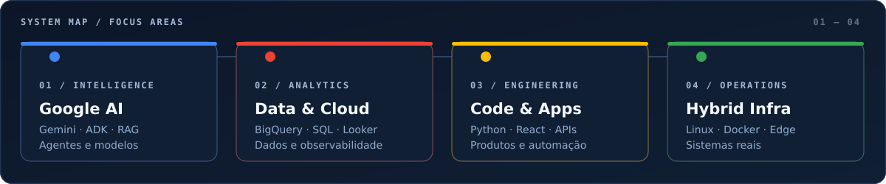

<!-- LUCAS-DEVHACK / PROFILE README EXPERIMENT · Google-inspired independent visual language. -->
<!-- This is the personal profile of Lucas Fernandes, NOT the devhack-platform account profile. -->

  

   

  
  
  
  

   

  <b>IA aplicada · Google Cloud · Dados · Automação · Desenvolvimento · Infraestrutura híbrida</b>

---

## `01 / Sobre mim` — tecnologia com olhar criativo

Sou **Lucas Fernandes**, um criativo e builder brasileiro. Minha trajetória começou no desenho, na tatuagem e na cultura maker; hoje exploro a interseção entre **inteligência artificial, engenharia de software, dados e infraestrutura**.

Gosto de sair do conceito e chegar a algo que funcione: desenvolver uma interface, conectar um agente a ferramentas, organizar um pipeline ou transformar um servidor Linux em uma plataforma de experimentação. Sou especialmente entusiasta do **ecossistema Google**, de suas ferramentas para IA e das possibilidades de construir com o Google Cloud.

> **Meu jeito de aprender:** construir → testar → medir → documentar → melhorar.

  

## `02 / Tech constellation` — quatro frentes que se conectam

  

| Área | Ferramentas e temas que estudo ou utilizo |
| :-- | :-- |
| 🟦 **Google AI & Agents** | Gemini, Google ADK, RAG, agentes com ferramentas, experimentos com modelos locais |
| 🟥 **Cloud & Analytics** | Google Cloud, BigQuery, SQL, Looker, Cloud Run, observabilidade |
| 🟨 **Software & Automation** | Python, JavaScript, React, Next.js, FastAPI, APIs, n8n |
| 🟩 **Hybrid Infrastructure** | Linux, Docker, Cloudflare, redes, GitHub Actions, automação operacional |

> **Aprendizado contínuo ≠ domínio certificado:** tecnologias em estudo, protótipos e experiência aplicada aparecem juntas no mapa, sem sugerir certificações ou competências verificadas que ainda não foram conquistadas.

## `03 / Selected builds` — projetos e experimentos

<table>
<tr>
<td width="50%" valign="top">

**🌐 LucasFernandes.work**

Meu hub profissional: portfólio, projetos, currículo e evolução em IA, dados e desenvolvimento.

<a href="https://lucasfernandes.work">Explorar site</a>

</td>
<td width="50%" valign="top">

**🧩 OCR Conversor**

Projeto público com versão desktop em Python/Tkinter e uma evolução web com FastAPI e Next.js.

<a href="https://github.com/lucas-devhack/ocr-conversor">Explorar código</a>

</td>
</tr>
<tr>
<td valign="top">

**🛠️ DevHack Labs**

Um laboratório de estudos, integrações, agentes, automações, aplicações e infraestrutura própria.

<a href="https://lucasfernandes.work/catalog">Ver projetos</a>

</td>
<td valign="top">

**🎨 House 67 Tattoo**

Projeto real que une presença digital, design, identidade, processos e automação de um estúdio criativo.

<a href="https://lucasfernandes.work/catalog">Ver no portfólio</a>

</td>
</tr>
<tr>
<td valign="top">

**🎙️ Narrabox**

Laboratório de narração, texto para áudio e experimentos com motores TTS.

Projeto em evolução; demonstração pública não anunciada aqui.

</td>
<td valign="top">

**🤖 Antigravity Kit — estudo**

Repositório de referência para agents, skills e workflows; preserva a atribuição ao projeto original de <a href="https://github.com/vudovn/ag-kit">Vudovn</a>.

<a href="https://github.com/lucas-devhack/antigravity-kit">Explorar repositório</a>

</td>
</tr>
</table>

Parte das aplicações é privada ou experimental. A vitrine mostra o que pode ser compartilhado sem expor infraestrutura, segredos ou repositórios internos.

## `04 / Quest log` — progresso real, sem XP fictício

| Missão | Estado | Evidência |
| :-- | :-- | :-- |
| Publicar portfólio profissional | ✅ Concluída | [lucasfernandes.work](https://lucasfernandes.work) |
| Compartilhar projeto técnico open source | ✅ Concluída | [OCR Conversor](https://github.com/lucas-devhack/ocr-conversor) |
| Evoluir em Google Cloud e IA generativa | 🔄 Em andamento | [Google Skills](https://www.skills.google/public_profiles/79186fc1-8a44-4eaa-86fe-e9232a5580b3) |
| Conectar README, site e currículo a uma fonte única de dados | 🧭 Planejada | Arquitetura em preparação |

<b>🧪 Abrir painel de missões futuras</b>

- [ ] Consolidar uma fonte única da verdade para os dados profissionais.
- [ ] Gerar o perfil GitHub e os currículos PT/EN a partir da mesma base.
- [ ] Exibir credenciais verificadas de Google Skills e Credly sem números inventados.
- [ ] Publicar mais estudos de caso com arquitetura, decisões técnicas e resultados.

## `05 / Learning signals` — credenciais verificáveis

Não existe atalho para experiência real. Prefiro mostrar a trajetória de aprendizado e deixar as evidências acessíveis.

- **Google Skills:** [perfil público, laboratórios e skill badges](https://www.skills.google/public_profiles/79186fc1-8a44-4eaa-86fe-e9232a5580b3).
- **Credly:** [credenciais e badges emitidos](https://www.credly.com/users/lucas-devhack/badges).
- **Google Cloud:** estudos com foco em IA generativa, ADK, agentes, dados e arquiteturas cloud.

<b>📊 Explorar atividade pública no GitHub</b>

  

O gráfico é fornecido por um serviço de terceiros e pode estar temporariamente indisponível. Ele não inclui necessariamente contribuições privadas.

---

  
   
  Perfil pessoal independente. Identidade visual inspirada nas quatro cores do Google; sem afiliação ou endosso oficial.

